<p align="right">
  <sub><a href="https://github.com/SimpleMindedMoron">GitHub</a> &nbsp;/&nbsp; <a href="https://linkedin.com/in/arjun-sanesh">LinkedIn</a> &nbsp;/&nbsp; <a href="https://github.com/SimpleMindedMoron/SimpleMindedMoron.github.io">Portfolio</a></sub>
</p>

## About

I'm currently living under a cemented rock, where I play with hardware and software, see what works, and learn from what doesn't. I like things that are small, fast, and clean, and I like them even more when they have wires attached.

```ini
[system]
user      = Arjun Sanesh
focus     = Clean, efficient software
exploring = Embedded systems, interactive UI design
off_duty  = Watching F1, building tools for daily annoyances
```

---

## Stack

| Category | Tools |
| :--- | :--- |
| **Languages** | `C` `C++` `Python` `JavaScript` `SQL` `HTML/CSS` |
| **Web** | `React` `Next.js` `Node.js` |
| **Data** | `PostgreSQL` |
| **Hardware** | `ESP32` `Arduino` `Embedded C` `ROS2 Jazzy` |

---

## Selected Work

### [Align](https://github.com/SimpleMindedMoron/minimal-calendar)
A responsive shared calendar and task tracker built to organize personal schedules and give group projects a shared space to visualize deadlines.

`Next.js` `Modular CSS` `PostgreSQL`

### [Embedded Systems / IoT](https://github.com/SimpleMindedMoron/iisc-final-project-automated-car)
Hobby electronics and autonomous hardware on ESP32 and Arduino, focused on hardware-software interfacing, sensor integration, and power management.

`ESP32` `Arduino` `Embedded C` `Python` `ROS2 Jazzy`

### [Portfolio Website](https://github.com/SimpleMindedMoron/SimpleMindedMoron.github.io)
Personal developer portfolio with a clean, card-based layout built with Flexbox and Grid.

`React` `Node.js` `Vanilla CSS`

---

## Connect

Have a project, a bug, or a blown fuse to discuss? Reach out on [LinkedIn](https://linkedin.com/in/arjun-sanesh) or find my work on [GitHub](https://github.com/SimpleMindedMoron).

<sub>Always building. Occasionally breaking things on purpose.</sub>
