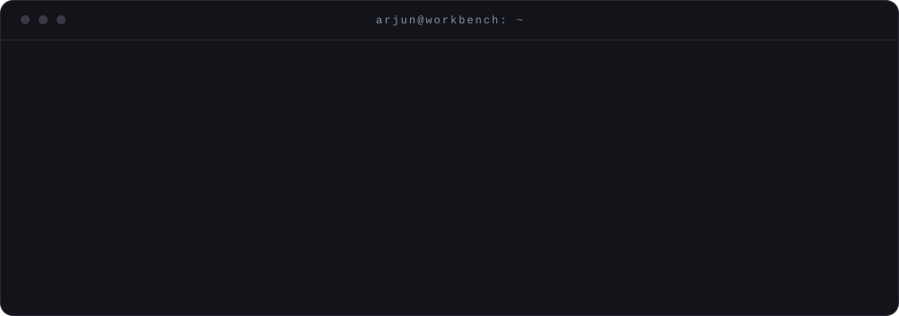
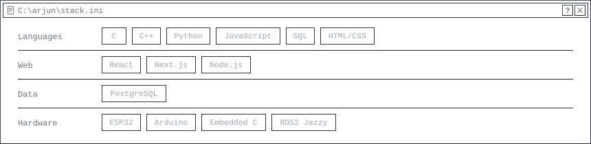
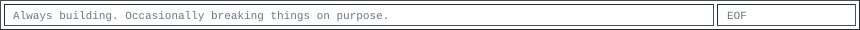

 

&nbsp;
&nbsp;

  

 

I'm currently living under a cemented rock, where I play with hardware and software, see what works, and learn from what doesn't. I like things that are small, fast and clean, and I like them even more when they have wires attached.

 

 

Click a project to expand it.

<b>01 &nbsp;&nbsp; ALIGN</b> &nbsp;/&nbsp; Shared calendar and task tracker

 

A responsive shared calendar app for keeping track of time and to-do tasks. I built it because I wanted to organize my life, and because group projects needed a shared space to visualize deadlines.

  

  

<b>02 &nbsp;&nbsp; EMBEDDED SYSTEMS / IOT</b> &nbsp;/&nbsp; Hobby electronics and autonomous hardware

 

Hobby electronics on ESP32 and Arduino, focused on hardware-software interfacing, sensor integration and power management.

  

  

<b>03 &nbsp;&nbsp; PORTFOLIO WEBSITE</b> &nbsp;/&nbsp; Personal developer portfolio

 

A responsive developer portfolio with a modern, card-based layout, built with Flexbox and Grid and tuned for clean navigation.

  

  

 

Have a project, a bug, or a blown fuse to discuss? Find me here.

&nbsp;

