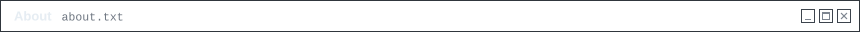
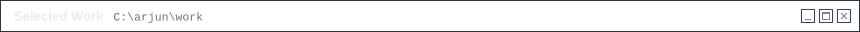

<p>
  <a href="https://github.com/SimpleMindedMoron">GitHub</a> &nbsp;/&nbsp;
  <a href="https://linkedin.com/in/arjun-sanesh">LinkedIn</a> &nbsp;/&nbsp;
  <a href="https://github.com/SimpleMindedMoron/SimpleMindedMoron.github.io">Portfolio</a>
</p>

<br>



I'm currently living under a cemented rock, where I play with hardware and software, see what works, and learn from what doesn't. I like things that are small, fast, and clean, and I like them even more when they have wires attached.

```text
focus       Clean, efficient software
exploring   Embedded systems, interactive UI design
off duty    Watching F1, building tools for daily annoyances
```

<br>


- **Languages:** `C` &nbsp; `C++` &nbsp; `Python` &nbsp; `JavaScript` &nbsp; `SQL` &nbsp; `HTML/CSS`
- **Web:** `React` &nbsp; `Next.js` &nbsp; `Node.js`
- **Data:** `PostgreSQL`
- **Hardware:** `ESP32` &nbsp; `Arduino` &nbsp; `Embedded C` &nbsp; `ROS2 Jazzy`

<br>



**[Align](https://github.com/SimpleMindedMoron/minimal-calendar)** - *Shared calendar and task tracker*  
A responsive shared calendar app built to organize personal schedules and give group projects a shared space to visualize deadlines.  
`Next.js` &nbsp; `Modular CSS` &nbsp; `PostgreSQL`

**[Embedded Systems & IoT](https://github.com/SimpleMindedMoron/iisc-final-project-automated-car)** - *Hobby electronics and autonomous hardware*  
Projects on ESP32 and Arduino focused on hardware-software interfacing, sensor integration, and power management.  
`ESP32` &nbsp; `Arduino` &nbsp; `Embedded C` &nbsp; `Python` &nbsp; `ROS2 Jazzy`

**[Portfolio Website](https://github.com/SimpleMindedMoron/SimpleMindedMoron.github.io)** - *Personal developer portfolio*  
A responsive developer portfolio with a clean card-based layout built with Flexbox and Grid.  
`React` &nbsp; `Node.js` &nbsp; `Vanilla CSS`

<br>


Have a project, a bug, or a blown fuse to discuss? Reach out on [LinkedIn](https://linkedin.com/in/arjun-sanesh) or check out my work on [GitHub](https://github.com/SimpleMindedMoron).

<br>

<sub>Always building. Occasionally breaking things on purpose.</sub>
